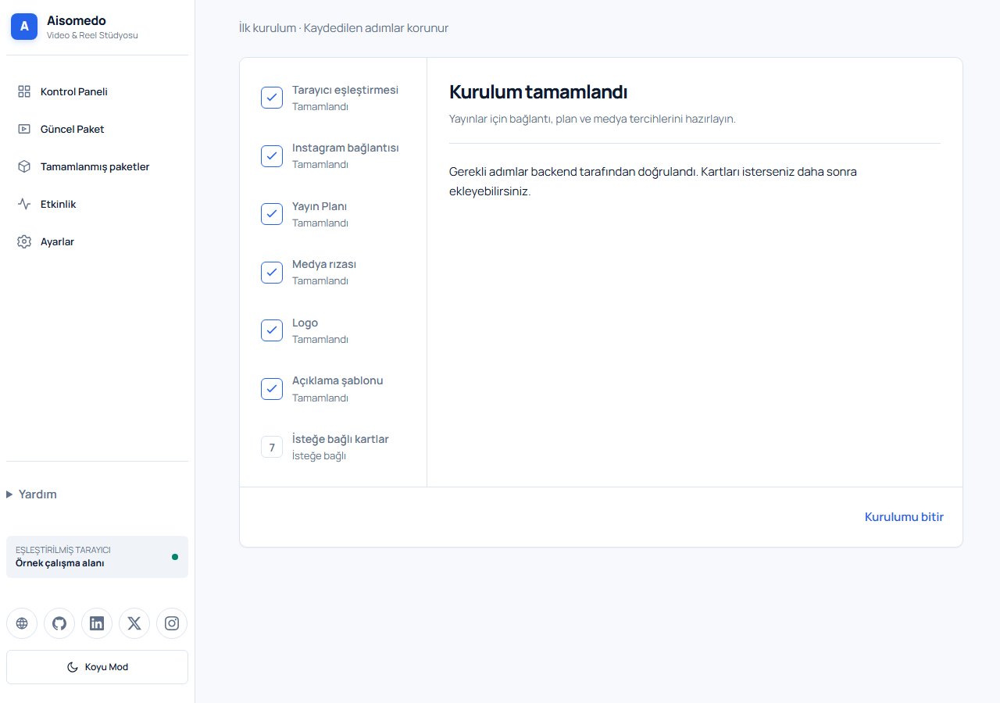

# First setup

[README](../../README.md) · [Publish a Reel](publishing-a-reel.md) · [Settings and recovery](settings-and-recovery.md)

This guide uses the web application. Its controls are in Turkish, so the instructions keep their visible names. See [Windows local setup](windows-local-setup.md) for the technology stack, environment settings, Meta token requirements, and native installation.

## 1. Start the local application

Install Git and Docker Desktop on Windows. Start Docker Desktop with Linux containers. From a new projects folder, run:

```powershell
git clone https://github.com/35HaRRy/aisomedo.git
Set-Location aisomedo
powershell -NoProfile -ExecutionPolicy Bypass -File .\ops\start-local.ps1 -PairingCode
```

If the repository already exists, run only the last line from its root. The script builds the application, initializes the database, waits for healthy services, and prints a short-lived pairing code. First startup needs an internet connection to download container images and packages.

Open **http://localhost:9081**. You should see the introduction. Choose **Uygulamayı aç** to connect your browser.

Local data uses Docker volumes under the `aisomedo-local` project. Configuration and generated secrets are stored in ignored `ops/.env.local`, not `ops/.env`. Keep that file private. Do not delete data volumes to fix a startup problem.

Check prerequisites without creating files or containers:

```powershell
powershell -NoProfile -File .\ops\start-local.ps1 -CheckOnly
```

## 2. Pair your browser

1. In **Eşleştirme kodu**, enter the code printed by the local startup command, or supplied by your installation’s operator.
2. In **Tarayıcı adı**, enter a name you will recognize.
3. Choose **Eşleştir**.

If the code expires or has been used, rerun the startup command with `-PairingCode`. A code works once. Every paired client has equal permissions; pair only trusted devices. No password or personal account is required.

## 3. Complete the setup wizard

Incomplete setup opens the wizard. Saved steps are retained. You may leave and return, but scheduling needs all required setup to be ready.

| Step | What to do |
| --- | --- |
| **Instagram bağlantısı** | Use the connection flow or enter an independently obtained supported token under **Instagram erişim tokenı**, then **Token ile bağlan**. The backend validates it. Never put a token in screenshots, URLs, or a shared document. |
| **Yayın Planı** | Choose the recurring plan’s Monday anchor, time, and time zone. Keep it disabled during exploration. The regular schedule is every other Monday. |
| **Medya rızası** | Read the current policy. Accept only if you have the necessary authority and permissions for the media. A new policy version requires explicit acceptance. |
| **Logo** | Upload a single-frame PNG or JPEG. |
| **Açıklama şablonu** | Save the default caption template for future publication material. |
| **İsteğe bağlı kartlar** | Add opening/closing cards if wanted, or skip. These do not block readiness. |

Logo/card uploads have their own size and format validation. Follow the error displayed rather than renaming an unsupported file. Settings changes do not silently rewrite an already prepared publication revision.



*Sample completed setup. This image is not proof that a real Instagram account is connected.*

Choose **Kurulumu bitir**. The dashboard shows the active package, publication timing, connection health, and any pending work.


## 4. Enable background work when needed

Local startup leaves the worker off. Rendering and scheduled preparation require it:

```powershell
powershell -NoProfile -ExecutionPolicy Bypass -File .\ops\start-local.ps1 -StartWorker
```

Read the warning and type `START` only for the intended local installation. The worker uses the same local database and media volume. Existing enabled schedules and stored Instagram credentials can have real effects; keep a test plan disabled while exploring. Starting a worker does not grant Instagram credentials or make local media publicly reachable.

## Real Instagram publishing prerequisites

The local HTTP site is for learning and development. For publication, the operator must configure a publicly reachable HTTPS installation, a supported Instagram professional account, Meta application settings and required permissions, and token encryption. OAuth callbacks must match the registered configuration. Instagram must be able to fetch the publication media from its signed HTTPS URL.

Do not turn off TLS validation or expose local database ports as a workaround. Obtain current account/permission requirements from [Meta’s official Instagram documentation](https://developers.facebook.com/docs/instagram-platform/) before configuring a real installation.

Local token encryption uses a generated key. Preserve it with the environment file; replacing a key can make existing stored credentials unreadable. OAuth application IDs/secrets are operator inputs, never copied from this guide.

## Restart, inspect, and stop

Run the startup command again to rebuild/start without resetting data. To inspect this installation:

```powershell
docker compose --env-file .\ops\.env.local -p aisomedo-local -f .\ops\docker-compose.prod.yml -f .\ops\docker-compose.local.yml ps
```

To stop its services while retaining containers and data:

```powershell
docker compose --env-file .\ops\.env.local -p aisomedo-local -f .\ops\docker-compose.prod.yml -f .\ops\docker-compose.local.yml stop
```

If startup fails, confirm Docker is ready, the internet connection works, and port 9081 is free. Inspect service status and logs; do not remove volumes or overwrite secrets. The script exits on Docker failure rather than generating a misleading pairing code.

## Help and walkthroughs

After setup, short Turkish tours explain important controls on the dashboard, package, review, and settings pages. **İleri** advances; **Geri** returns to the previous step. Close or Escape dismisses the current tour. **Tüm tanıtımları geç** suppresses all automatic tours, including pages not yet visited.

Use **Yardım → Tanıtımları yeniden başlat** to replay, or **Uygulama tanıtımı** to reopen the landing page. Preferences belong to that paired client in that browser. Clearing browser storage resets them; another device has its own preferences. When browser storage is blocked, suppression lasts only for the current session.

Next: [prepare and publish a Reel](publishing-a-reel.md).

## Android installation and connection

These steps cover installation and connection only. Follow the web publishing guide for the shared workflow.

1. Download the [signed v0.2.0 APK](https://github.com/35HaRRy/aisomedo/releases/download/android-v0.2.0/aisomedo.apk) and [checksum file](https://github.com/35HaRRy/aisomedo/releases/download/android-v0.2.0/aisomedo.apk.sha256). Use only trusted release assets.
2. Open the APK on Android. Allow installation from that source if asked, then install.
3. Open Aisomedo and enter your operator-provided **HTTPS server address**.
4. Obtain a fresh one-time pairing code for that installation. Enter the code and a recognizable device name.
5. Finish connection. Follow any notification permission request if you want supported review reminders.

For a Windows download, verify its checksum before transfer:

```powershell
Get-FileHash .\aisomedo.apk -Algorithm SHA256
Get-Content .\aisomedo.apk.sha256
```

The two hash values should match, ignoring letter case. A checksum detects changed bytes; it is not a substitute for downloading from the trusted release.

The release app needs a reachable server, not `localhost:9081` on the phone. This guide’s local gateway listens only on Windows loopback and has no public HTTPS endpoint. Do not weaken release transport security to connect a phone to it.
