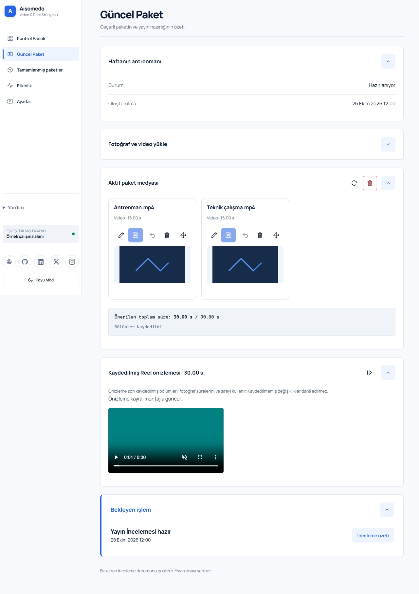
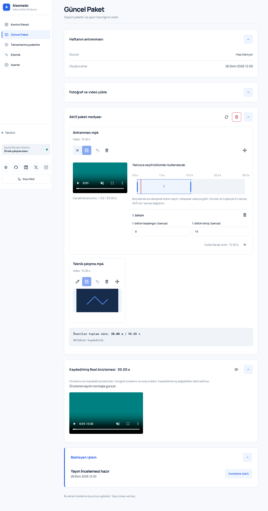
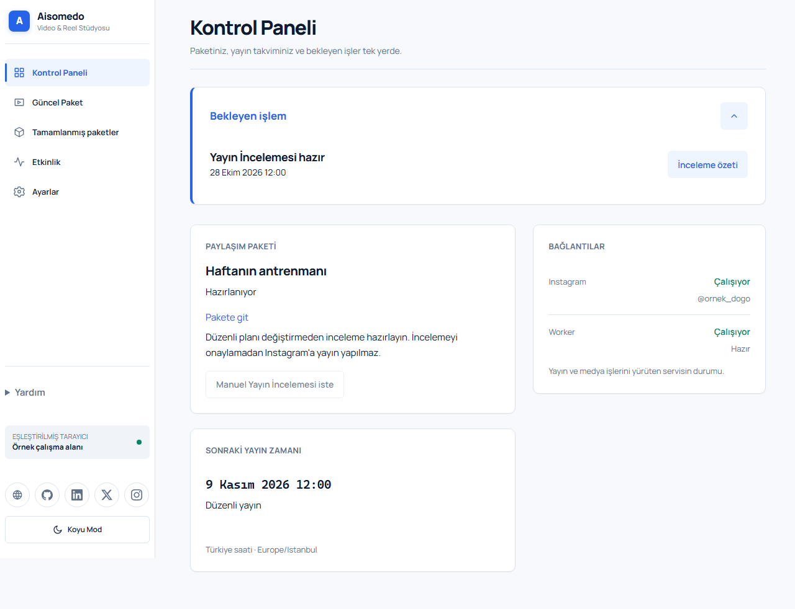
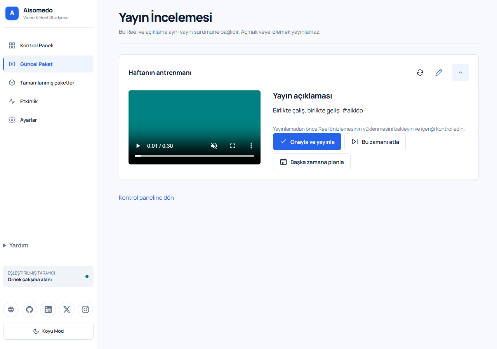
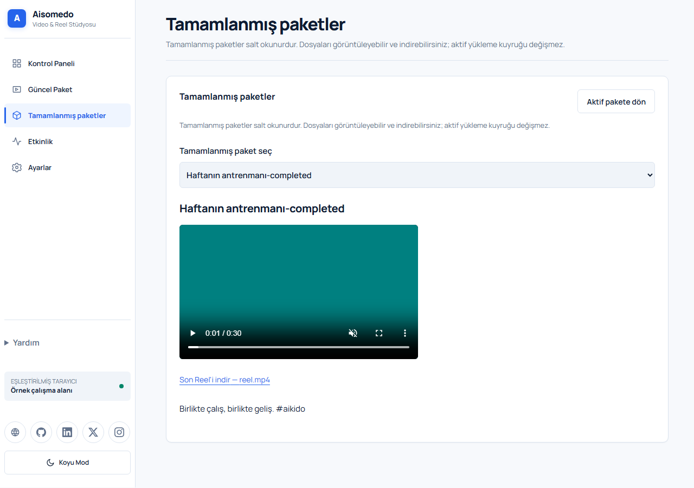

# Prepare, review, and publish a Reel

[README](../../README.md) · [First setup](getting-started.md) · [Settings and recovery](settings-and-recovery.md)

Use the web application for this flow. Complete setup and start the worker before rendering. Real publication also needs the account, permissions, and HTTPS setup described in the first-setup guide.

The example package is **Haftanın antrenmanı**. Screenshots show real application screens with synthetic demo data, not a real Instagram publication.

## 1. Upload media

Open **Güncel Paket**. Expand **Fotoğraf ve video yükle**, then choose **Fotoğraf ve video seç**. Select supported photos or videos. The screen shows the current file and package limits.

Wait for **Pakete eklendi**. “Queued” or “processing” is not accepted media yet: the backend still needs to validate the file. You can pause or resume an upload. After a page refresh, select the same original file again when asked; the browser does not keep the file bytes.

If a filename conflicts, decide whether to keep both files, keep the existing one, or replace it. Replacing requires explicit confirmation and is not reversible. [Conflict and upload recovery details →](settings-and-recovery.md#upload-and-filename-problems)

## 2. Arrange and edit

In **Aktif paket medyası**, use the **Sürükle** handle to arrange media. Keyboard alternatives are available through the media order controls. Choose **Paketten çıkar** to leave a file out of the montage; **Geri yükle** returns it without re-uploading the original.

For a video, choose **Bölümleri düzenle** (the edit icon). Select the intervals you want to keep on the timeline, or enter precise start/end values. An empty selection uses the whole video. Multiple retained intervals play in source order; they do not become a rearranged set of independent clips.

Use **Bölüm ekle** to add an interval and adjust its boundaries. Correct invalid or overlapping ranges. For a photo, set **Gösterilme süresi (sn)**. The proposed total includes retained video, photos, and configured cards. Reduce the total if it exceeds the displayed limit.

Save the changes with **Bölümleri kaydet** or the relevant save control. Unsaved changes are drafts, not input to the saved Reel. If you leave with unsaved edits, use the save/discard/stay choice deliberately. A stored draft is not a completed server save.

**Do not use Paketi temizle to remove one file.** It permanently deletes the active package’s media, removed files, render output, and related records after confirmation. Completed packages and general settings are separate.

## 3. Render and open a review

In **Kaydedilmiş Reel önizlemesi**, choose **Kaydedilmiş montajı render et** using the render icon. The worker prepares the saved montage. Wait for a ready preview. Ordering or section changes make an existing render stale; render again after saving.

The saved preview is for checking your material. It is not approval and does not publish.

For the scheduled flow, the configured regular plan creates a due publication opportunity. Open the pending action from **Kontrol Paneli**. If the package still needs preparation, continue the upload/render flow until the review is ready. A disabled plan does not create scheduled publishing work.

For an explicit manual flow, use **Manuel Yayın İncelemesi iste** from the dashboard. This requests a review without changing the regular plan. Follow the displayed preparation/continuation action; do not repeatedly request a new review while the first request is pending or uncertain.

Open **Yayın İncelemesi**. Wait for the preview to load, watch it, and check **Yayın açıklaması**. This video and caption belong to the same publication revision. Merely opening or watching the review cannot publish it.

## 4. Make a decision

| Choice | Result |
| --- | --- |
| **Onayla ve yayınla** | Starts the approval flow. Read the warning, then choose **Yayınlamayı onayla** only if you intend to publish now. |
| **Bu zamanı atla** | After confirmation, skips this occurrence and stops its reminders. The package and regular plan remain. |
| **Başka zamana planla** | Closes this review and creates a new review time for the same package. Choose a future Istanbul time before the next regular time, where one exists, then confirm. |

Approval can have an immediate external effect. Never click it only to test the interface on a real account.

If the review changed on another device, refresh and recheck it. Do not retry an uncertain approval blindly: first inspect the dashboard and Instagram to learn whether the publication happened. [Failure and uncertain-send recovery →](settings-and-recovery.md#publication-failures)

## 5. Check completion

After Instagram confirms successful publication, the package becomes a **Tamamlanmış Paket**. It appears under **Tamamlanmış paketler** and is read-only. A skipped, rescheduled, failed, or still-publishing package is not completed.

Open a completed package to inspect available media and the final Reel. Download links require a paired client; missing files are shown as unavailable. Visiting the archive does not move your active upload queue into a past package.

Use **Etkinlik** to inspect the recorded actions. For settings, connection health, and safe retry rules, see [settings and recovery](settings-and-recovery.md).
