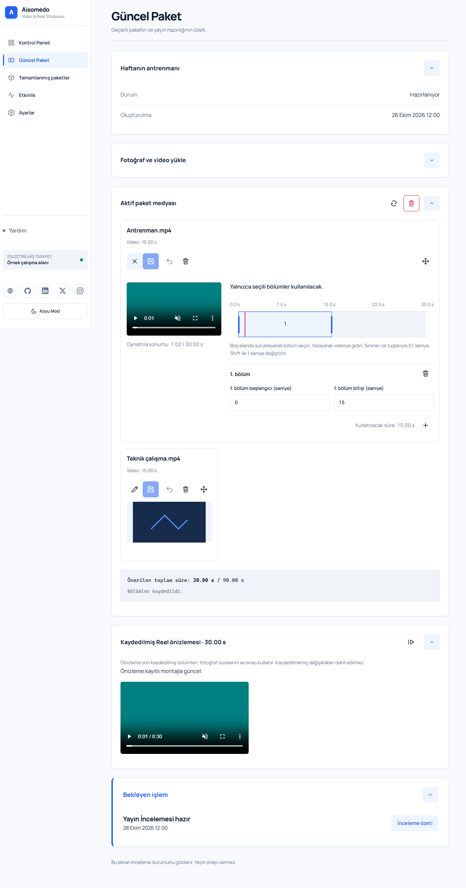
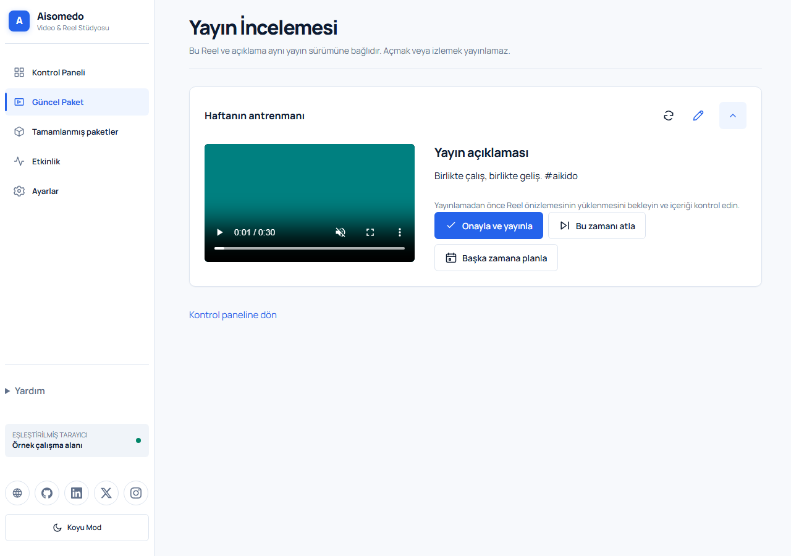
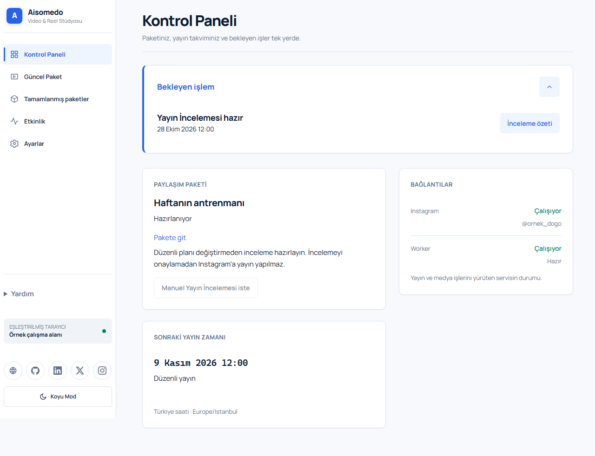

# Aisomedo launch post

Use the text below as one bilingual LinkedIn post. Attach the images in the order listed afterward; LinkedIn does not render local Markdown image links inside pasted post text.

## Türkçe

📸🎬 Fotoğraflar ve videolar birikti. Peki paylaşım hazırlığı?
🚀 Bu süreci tek yerde toplamak için geliştirdiğim Aisomedo'yu paylaşmak istiyorum.
🤖 Aisomedo, fotoğraf ve videoları markalı Instagram Reels'lerine dönüştürmesine yardımcı olan, 🖥️ kendi sunucunuzda çalışan bir uygulama.
🔄 Akış basit: 📤 medyayı yükle → 🔀 sırala ve bölümleri seç → 👀 hazırlanan Reel'i incele → ✅ onayla ve yayınla.
🗓️ Yayınlar planlı, 🧑 son karar insanda. Önizlemeyi açılabilir; içerik hazır değilse inceleme atlanabilir veya başka zamana taşınabilir ⏭️ Yalnızca Instagram'ın doğruladığı yayınlar tamamlanmış sayılıyor ✔️.
🛠️ Proje; FFmpeg tabanlı video hazırlığını ve ayrı bir yayın worker'ını bir araya getiriyor.

## English

📸🎬 Photos and videos are ready. What about preparing the post?
🚀 A project I built to bring that work into one place.
🤖 Aisomedo is a self-hosted application that helps turn photos and videos into branded Instagram Reels. 🖥️
🔄 The flow is simple: 📤 upload media → 🔀 choose the order and video sections → 👀 review the Reel → ✅ approve and publish.
🗓️ Posts are scheduled, but the final decision rests with the user 🧑 You can open the preview; if the content isn’t ready, you can skip the review or reschedule it for a later time ⏭️ Only posts verified by Instagram are considered complete.
🛠️ The project combines FFmpeg-based video preparation with a separate posting worker.

#Aisomedo #FullStack #React #TypeScript #Kotlin #FastAPI #InstagramReels

### 1. From media to a montage / Medyadan kurguya

Attach: `web/public/promotion/web/sections.png`. Caption: “Choose what stays. / Kalacak bölümleri seç.”

### 2. Human approval / Son karar insanda

Attach: `web/public/promotion/web/review.png`. Caption: “Review first. Publish only after approval. / Önce incele, onaydan sonra yayınla.”

### 3. One workspace / Tek çalışma alanı

Attach: `web/public/promotion/web/dashboard.png`. Caption: “Your package, plan, and pending work. / Paket, plan ve bekleyen işler bir arada.”
